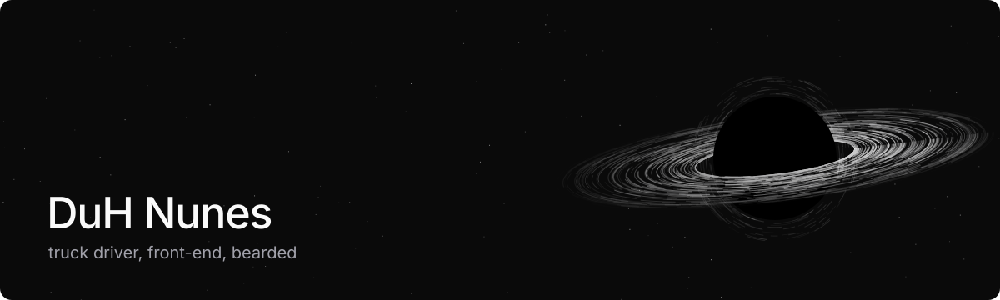

<!--
  you opened the source.
  that's how it starts: a little closer than you meant to.
-->

[rdx](https://github.com/lexibase/rdx) · [scs-intellisense](https://github.com/duhnunes/scs-intellisense)

<code>~/limbo</code>

 

nothing here. just the void,\
a few old experiments drifting: [codepen](https://codepen.io/DuH-Nunes)\
and me, thinking about 874 different things.

<!-- nothing comes back out. not even this. -->

[duhnunes.dev](https://duhnunes.vercel.app) · [linkedin](https://linkedin.com/in/duhnunes/) · [email](mailto:duhnunes.dev@gmail.com)
